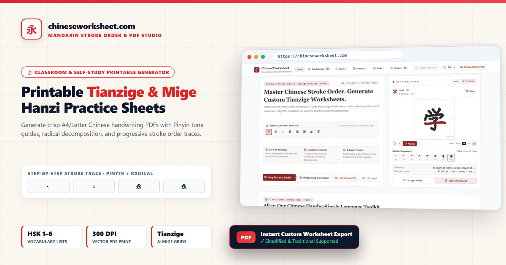

# ChineseWorkSheet — Vector Hanzi Grid Geometry, Stroke Order & HSK Analyzer (`com.chineseworksheet/mcp`)

Official **Model Context Protocol (MCP)** remote `streamable-http` server and **Open Agent Skill** for [**ChineseWorkSheet (chineseworksheet.com)**](https://chineseworksheet.com).

---

## 🔧 Available MCP Tools

### `calculate_worksheet_grid_geometry`
Calculate exact physical millimeter and PostScript point dimensions for printable Chinese writing grids (Tian Zi Ge, Mi Zi Ge, Jiu Gong Ge, Hui Zi Ge) on A4 or US Letter paper.

### `lookup_chinese_stroke_order_rules`
Retrieve official Chinese Ministry of Education stroke ordering rules (horizontal before vertical, top-to-bottom, outside before closing) and the 8 fundamental calligraphy stroke primitives.

### `analyze_hsk_vocabulary_level`
Classify Chinese characters or vocabulary sentences into official HSK proficiency tiers (HSK 1 to HSK 7-9), CEFR language equivalents (A1 to C2), and recommend matching printable worksheets.

### `convert_pinyin_tone_format`
Convert between Mandarin Pinyin tone diacritics (ma1 -> mā) and numeric tones, decompose syllables into Initial, Final, Tone, and apply standard vowel tone placement hierarchy (a > o > e > i/u > ü).

### `lookup_kangxi_radical_info`
Look up core Kangxi Chinese character radicals (e.g. 氵, 木, 火, 讠, 心, 扌, 女, 口) with semantic meaning, stroke count, typical structural placement, and high-frequency character examples.

### `recommend_chinese_practice_pack`
Generate a structured Chinese character handwriting curriculum plan and direct printable sheet links tailored by learner age group, proficiency target, and grid preference.

---

## 📄 License

MIT © [ChineseWorkSheet](https://chineseworksheet.com)
